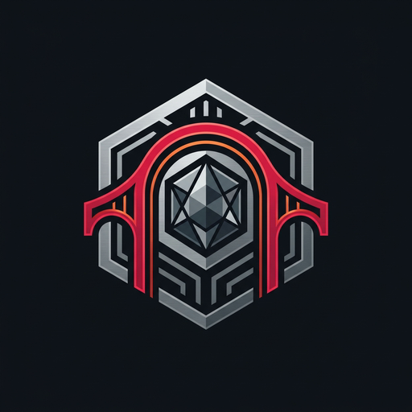
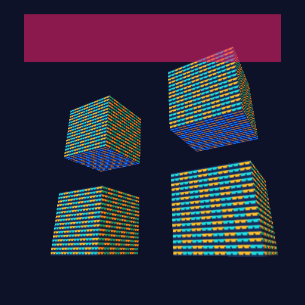
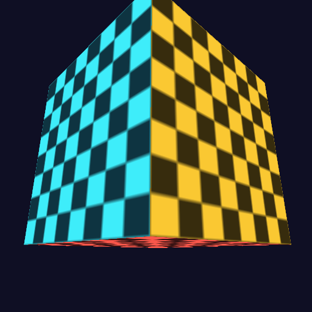
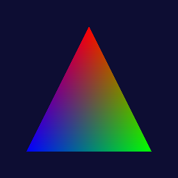

<h1 align="center">
  <br>
  
  <br>
  <b>ScarletBridge</b>
  <br>
</h1>

<h4 align="center">
  Native <b>Linux</b> compatibility layer for Xbox GDK / Series X (Scarlett) &amp; UWP PE32+ x86-64 binaries — written in <b>100% pure Rust</b>, with <b>zero Wine</b> and <b>zero C/C++</b>.
</h4>

<p align="center">
  
  
  
  
  <a href="#license"></a>
</p>

<p align="center">
  <a href="#why-linux-native--100-rust">Why Linux &amp; Rust?</a> |
  <a href="#project-status">Status</a> |
  <a href="#screenshots">Screenshots</a> |
  <a href="#how-to-build">How to build</a> |
  <a href="#how-it-works">How it works</a> |
  <a href="#want-to-help">Want to help?</a> |
  <a href="#credits">Credits</a> |
  <a href="#license">License</a>
</p>

ScarletBridge is built **specifically for Linux** and written **100% in Rust (Edition 2024)**. Because Xbox One / Series consoles share the x86-64 CPU architecture with a Linux PC, unencrypted PE32+ x86-64 executables and DLLs are mapped and executed natively in-process on the Linux kernel — **no Windows, no Wine, no Proton, no C/C++ shims, and no Python/.NET build scripts**. Win32, Xbox GameOS/GDK, WinRT, `xmem.dll`, XAudio2, and Direct3D 12 (`d3d12_xs.dll`) are reimplemented in a single Cargo workspace directly on top of **Linux**, **Vulkan 1.4**, **Wayland/SDL3**, and **PipeWire**.

> [!IMPORTANT]
> This repository **does not contain any commercial games, encryption keys, or copyrighted SDK/system binaries**, and it does not decrypt or bypass DRM. ScarletBridge targets **unencrypted PE32+ x86-64 homebrew, open-source engines, SDK samples, and custom test harnesses** only. Never attach commercial game files or copyrighted assets to issues or pull requests.

## Why Linux-native & 100% Rust?

- **Linux-first architecture (zero Wine / zero Windows):** Talks directly to Linux primitives (`mmap`, `arch_prctl(ARCH_SET_GS)` for Win64 `TEB`/`PEB`, `pread`/`pwrite`, native POSIX threads & futexes), **Vulkan 1.4** (Mesa RADV / ANV / NVIDIA / Lavapipe), **Wayland/X11 via SDL3**, and **PipeWire** audio — no Wine prefix, no external translation stack.
- **100% pure Rust (single Cargo workspace):** The PE32+ loader, Win64 JIT trampolines, DXBC → SPIR-V 1.3 shader compiler, DXIL SM 6.x parser, Vulkan 1.4 3D/Compute renderer, sandboxed VFS, HLE shims, guest DLLs, and test harnesses are all pure **Rust (Edition 2024)** — zero `.c`/`.cpp` shims, one `cargo test --workspace` builds and checks everything.
- **Safety & ABI discipline by construction:** Strict `extern "win64"` ABI with compile-time `size_of`/`offset_of` checks, `ffi_guard!` panic firewalls (zero unwinding across FFI), `clippy::unwrap_used = "deny"`, isolated `unsafe` blocks with `// SAFETY:` invariants, sandboxed VFS (never exposes host `/home`), and offline-by-default networking.

## Project status

**Early active development — core runtime & 3D/Compute Vulkan pipeline work end-to-end on real hardware.** The workspace has **320+ unit tests** (`cargo test --workspace`, all passing, `clippy` and `rustfmt` clean) plus **8** cross-compiled PE32+ x86-64 harnesses under `tests/harness/` (including `api_conformance`, which exercises the CRT, Win32, Winsock, `bcrypt` and `rpcrt4` APIs through a real PE import table); developed and tested natively on Linux (AMD Radeon RX 5700 XT / Mesa RADV Vulkan 1.4) with zero Wine.

| What | Status |
|---|---|
| Native PE32+ x86-64 loader (`mmap`, relocs, `TEB`/`PEB` on `GS`, `.tls`, IAT, Win64 JIT stubs) | ✅ Works — loads and executes `.exe` + dynamic `.dll` modules natively without Wine |
| Win64 multi-threading, sync & 64-bit sandboxed VFS I/O | ✅ Works — real OS threads, per-thread `Tls*`/`Fls*` destructors, `CRITICAL_SECTION`, `SRWLOCK`, `CONDITION_VARIABLE`, 256-bucket `WaitOnAddress` futex, waitable timers, concurrent `OVERLAPPED` `pread`/`pwrite`, `MapViewOfFile`, `IOCP` |
| Shaders: DXBC SM4/SM5 → SPIR-V 1.3 (VS, PS, CS) | ✅ **60/60** real Microsoft `fxc` shaders (OpenLara Xbox) translated **without skipped opcodes** and validated by `spirv-val --target-env vulkan1.3` (measured by `cargo test -p sb-gpu --test dxbc_corpus -- --nocapture`). Structured control flow (`if/else`, `loop`, `switch`, `break/continue`, `ret/retc`, `discard`, `call/label`), integer/bit ops, all `sample*`/`gather4*`/`ld*`/`resinfo`/`lod` variants, typed/raw/structured UAVs, groupshared, atomics and barriers. ⚠️ Geometry/Hull/Domain stages, doubles, `msad`, `samplepos`, `swapc`, append/consume buffers and SM5.1 descriptor arrays fail cleanly with a typed error |
| Shaders: DXIL SM 6.x (`LLVM 3.7` bitstream) | ⚠️ Parser only — decodes `DxilProgramHeader` and LLVM bitstream blocks/records; SPIR-V codegen not yet implemented |
| Vulkan 1.4 3D + Compute renderer (`sb-gpu`) | ✅ Works — checked on AMD RADV: RGBA8 + D32F, 256-thread Compute Dispatch, hardware **BC1–BC7** & HDR textures, custom vertex layouts, alpha blending, culling, wireframe, scissor rects, instancing, disk-backed `VkPipelineCache`, SDL3/Wayland swapchain |
| Xbox D3D12 (`d3d12_xs.dll`) & `dxgi.dll` → Vulkan | ✅ Core pipeline works — Graphics & Compute PSOs, `CreateHeap` + `CreatePlacedResource` memory aliasing, `CheckFeatureSupport`, `D3D12SerializeRootSignature`, `Dispatch`, `DrawIndexedInstanced`, `CopyTextureRegion`, `CopyResource` GPU→CPU readback. ⚠️ Single RT0 only (MRT, ExecuteIndirect & DXR not yet wired) |
| Unified memory (`xmem.dll`) & AMD RDNA 2 tiling | ✅ Works — 64 KiB aligned `VK_EXT_external_memory_host` CPU/GPU memory + 2D tile/detile (`xg_tiling`) |
| Direct3D 11 & WinRT/UWP (`d3d11.rs`, `winrt_objects.rs`) | ⚠️ In progress — OpenLara Xbox boots natively, initializes D3D11→Vulkan + XAudio2 + 6 WinRT classes, and writes `S:\perlin3_128.raw`; D3D11 `CreateInputLayout` & `CreateTexture2D(pInitialData)` still needed for full 3D frames |
| Xbox GDK GameOS, Audio & Input (`XTaskQueue`, `XUser`, `XAudio2_9`, `GameInput`, strict offline `XCurl`/`libHttpClient.GDK`) | ✅ Core works — multi-threaded `XTaskQueue`, SDL3 Gamepad, PipeWire/SDL3 audio, offline-by-default. ⚠️ Multi-voice XMA2 decoding & WinRT keyboard/mouse events not yet wired |
| Win32 / UCRT / MSVC runtime HLE (`kernel32`, `api-ms-win-*`, `ucrtbase`, `msvcp140`, `vcruntime140`, `bcrypt`, `rpcrt4`, `dbghelp`, ntuser) | ✅ Broad coverage — C runtime (`printf`/`scanf` engines, `strto*`, time, math with `errno`), STL iostreams/locale layouts, `setjmp`/`longjmp`, RTTI `__RTDynamicCast`, `.pdata` unwinding (`RtlVirtualUnwind`), file I/O through the sandboxed VFS. ✅ Exceptions: Windows x64 SEH and MSVC C++ (`_CxxThrowException`, `__CxxFrameHandler3/4`, `__C_specific_handler`, vectored handlers, hardware faults as SEH exceptions) propagate for real, validated by the `eh_test` harness (`catch_unwind`, `Drop` during unwinding). ⚠️ The FH4 decoder is reconstructed from public descriptions and checked only against synthetic tables |
| Offline-first networking (`ws2_32`, `winhttp`, `libHttpClient.GDK`) | ✅ Winsock by name **and ordinal**, WinHTTP and the full libHttpClient surface; strictly offline by default (non-loopback traffic fails with the documented Windows error codes), loopback works. ⚠️ No TLS, no WebSockets |
| Xbox GDK runtime classes (`xgameruntime`: threading/`XAsync`, `XUser`, `XNetworking`, `XGameSave`, `XStore`, `XPackage`, …), DirectStorage, `xmem` physical pages | ✅ Served through `QueryApiImpl` with a single offline local user; unknown slots fail cleanly (`E_NOTIMPL`) and are logged by name. ⚠️ Several console-specific interface layouts are **inferred**, not documented — see the code comments |
| Encrypted / commercial Xbox Series games | ❌ No — out of scope by design (unencrypted PE32+ x86-64 binaries only) |

## Bundle compatibility (bring your own files)

ScarletBridge is designed for **maximum compatibility with Xbox / GDK application bundles that you legitimately own and that are already readable on disk** (unencrypted PE32+ x86-64 executables and DLLs) — homebrew, open-source engines, SDK samples and your own builds. **No game, key or system binary is shipped here**, nothing is decrypted, and no protection is bypassed; the project cannot and does not guarantee that any particular commercial title will run.

Because compatibility depends on which APIs a bundle imports, the tooling is built to tell you exactly what is covered and what is not:

```sh
# 0. Is this machine ready? (kernel limits, free load addresses, CPU level, Vulkan, SDL3, display, audio, permissions)
./target/release/scarletbridge doctor

# 1. Everything a binary or bundle asks for — static analysis, nothing is executed:
#    load address, imports and delay-loads by support tier, GDK classes, embedded DXBC/DXIL shaders,
#    CPU instructions actually used, cited files, required features and machine needs (--json for all)
./target/release/scarletbridge requirements /path/to/bundle/app.exe

# 1b. Only the import coverage, with the list of missing symbols
./target/release/scarletbridge inspect --missing /path/to/bundle/app.exe

# 2. Run it, recording the last API calls (with decoded string arguments) for crash reports
SB_TRACE_API=1 SB_LOG=info ./target/release/scarletbridge run /path/to/bundle/app.exe
```

| Variable | Effect |
|---|---|
| `SB_TRACE_API=1` / `live` | Wraps every imported API in a transparent thunk and keeps the last 256 calls (name, 4 first arguments, ASCII/UTF-16 string previews); `live` also logs each call |
| `SB_UNIMPLEMENTED=stop` | Stops at the first not-yet-implemented import and prints `dll!symbol`, the caller as `module+RVA` and the argument registers (default: `log` and continue) |
| `SB_GUEST_DLLS=msvcp140,concrt140` | Prefer the redistributable DLLs shipped *with the bundle* over the built-in HLE for the listed modules (opt-in) |
| `SB_OFFLINE_MODE` | Strict offline mode, **on by default** |
| `SB_LOG=info` / `debug` / `trace` | Log verbosity |

On a guest crash (`int3`, `SIGSEGV`, …) ScarletBridge prints a report with the faulting `module+RVA`, all registers, the code bytes around RIP, the top of the stack, the guest call stack rebuilt from the PE `.pdata` tables, and — for faults in host code — the host library and symbol (`dladdr`).

## Screenshots

Rendered natively on Linux (AMD Radeon RX 5700 XT / RADV Vulkan 1.4) by cross-compiled Windows **PE32+ x86-64 `.exe`** harnesses calling `d3d12_xs.dll` & `dxgi.dll` through ScarletBridge:

| AAA Pipeline Benchmark (`aaa_pipeline_bench.exe`) | 3D Textured Cube (`d3d12_cube.exe`) | D3D12 Triangle (`d3d12_triangle.exe`) |
| :---: | :---: | :---: |
|  |  |  |
| 256-thread GPU Compute → 4 instanced cubes (`SV_InstanceID`), hardware **BC1** texture, 36B vertex layout, **Alpha Blending** HUD & **Scissor** clipping | Perspective 3D cube with MVP in `cb0`, `u16` index buffer, `D32_SFLOAT` depth occlusion & 2D texture sampling (`t0`/`s0`) | End-to-end PE32+ `d3d12_xs.dll` → DXBC → SPIR-V → Vulkan 1.4 triangle + GPU readback |

## How to build

**The easy way (with [`mise`](https://mise.jdx.dev/)):**

1. Clone the repository and let `mise` install the matching Rust & Zig toolchains:
   ```sh
   git clone https://github.com/t-chahbi/ScarletBridge
   cd ScarletBridge
   mise install
   ```
2. Run the full test suite (unit tests, SPIR-V validation, and live Vulkan 3D/Compute tests):
   ```sh
   mise exec -- cargo test --workspace
   ```

**Prerequisites:**

- **Linux x86-64** with a Vulkan 1.3+ driver (AMD RADV, Intel ANV, NVIDIA, or `mesa-vulkan-drivers` Lavapipe for headless software Vulkan).
- **Rust stable (Edition 2024)** and either **Zig** (auto-installed via `mise.toml`) or `mingw-w64` + `llvm-dlltool` for cross-compiling the Windows PE32+ test DLLs and harnesses.
- **Optional:** `spirv-tools` (`spirv-val`, enables SPIR-V validation in unit tests), `SDL3` (live Wayland/X11 windowing and gamepad), `PipeWire` (audio).

**From a terminal**, cross-compile the PE32+ x86-64 test DLLs & harnesses and run them natively on Linux (zero Wine):

```sh
# 1. Build the native Linux launcher + cross-compile PE32+ x86-64 test binaries
mise exec -- cargo build -p sb-launcher
mise exec -- cargo build --target x86_64-pc-windows-gnu \
  -p sb-dll-xmem \
  -p sb-harness-dll-probe \
  -p sb-harness-seriesx-smoke \
  -p sb-harness-mt-io-stress \
  -p sb-harness-d3d12-triangle \
  -p sb-harness-d3d12-cube \
  -p sb-harness-aaa-pipeline-bench

# 2. Run the AAA GPU + Compute benchmark (omit --headless to open a live Wayland/SDL3 window)
SB_LOG=info ./target/debug/scarletbridge run --headless --dump-frame tmp/aaa_bench.ppm \
  target/x86_64-pc-windows-gnu/debug/aaa_pipeline_bench.exe

# 3. Run the 3D textured cube, multi-threading/IOCP stress test, and dynamic xmem.dll probe
SB_LOG=info ./target/debug/scarletbridge run --headless --dump-frame tmp/d3d12_cube.ppm \
  target/x86_64-pc-windows-gnu/debug/d3d12_cube.exe
SB_LOG=info ./target/debug/scarletbridge run --headless \
  target/x86_64-pc-windows-gnu/debug/mt_io_stress.exe
SB_LOG=info ./target/debug/scarletbridge run --headless \
  target/x86_64-pc-windows-gnu/debug/dll_probe.exe -- xmem.dll --self-test-xmem

# 4. Inspect any unencrypted PE32+ binary's imports/exports
./target/debug/scarletbridge inspect target/x86_64-pc-windows-gnu/debug/aaa_pipeline_bench.exe
```

Useful environment flags:
- `SB_LOG=info` or `SB_LOG=debug,d3d12_xs=trace` — structured per-channel tracing.
- `SB_HEADLESS=1` (or `--headless`) — offscreen Vulkan execution without opening a window.
- `SB_DUMP_FRAME=path.ppm` (or `--dump-frame`) — save the rendered GPU backbuffer on `Present`.
- `SB_VK_VALIDATION=1` — enable `VK_LAYER_KHRONOS_validation`.
- `SB_OFFLINE_MODE=1` — strict offline mode (enabled by default).

## How it works

| Piece | What it does | Where |
|---|---|---|
| PE32+ native loader | Maps PE sections with `mmap`, applies base relocations, sets up Win64 `TEB`/`PEB` via `arch_prctl(ARCH_SET_GS)`, clones `.tls` per thread, resolves IAT entries, and generates Win64 x86-64 JIT stub trampolines | `crates/sb-loader/` |
| HLE runtime (`extern "win64"`) | Implements Kernel32, OS threading, sync (`SRWLOCK`, `CONDITION_VARIABLE`, futex), 64-bit `OVERLAPPED` I/O & IOCP, UCRT, Xbox GDK (`XTaskQueue`, `XUser`, offline `XCurl`), WinRT, XAudio2, D3D11, `d3d12_xs`, and `dxgi` | `crates/sb-hle/` |
| Shader compiler & Vulkan engine | Translates DXBC SM4/SM5 (VS/PS/CS) to SPIR-V 1.3, parses DXIL SM 6.x LLVM 3.7 bitstreams, runs 3D + Compute pipelines on Vulkan 1.4 with disk-backed `VkPipelineCache`, hardware BC1–BC7 textures, `VK_EXT_external_memory_host`, and RDNA 2 tiling | `crates/sb-gpu/` |
| Sandboxed VFS & offline runtime | Maps `G:\`, `S:\`, `T:\`, `D:\` into isolated per-title directories (blocking `..` and symlink escapes), parses `AppxManifest.xml` / `MicrosoftGame.config`, enforces save quotas, and manages offline user profiles | `crates/sb-vfs/`, `crates/sb-runtime/` |
| Guest DLLs & CLI tools | Cross-compiled Win64 guest DLLs (`xmem.dll`, `xaudio2_9.dll`, UWP CRT shims), `scarletbridge` launcher, and `sb-stubgen` PE analyzer / Rust stub generator | `crates/dlls/`, `crates/tools/` |
| PE32+ integration harnesses | Self-verifying cross-compiled `.exe` tests exercising dynamic DLL loading, GameOS, multi-threading/IOCP, D3D12 3D rendering, and the full AAA Compute + BC1 + Instancing pipeline | `tests/harness/` |

All design notes, ABI references, and roadmaps are indexed in [docs/README.md](docs/README.md). The full phase blueprint lives in [LLM.md](LLM.md), strict ABI/safety rules in [AGENTS.md](AGENTS.md), and upcoming milestones in [ROADMAP.md](ROADMAP.md).

## Want to help?

The biggest open pieces where contributors can jump straight in:

- **DXIL SM 6.x → SPIR-V 1.3 codegen** (`crates/sb-gpu/src/dxil.rs`): turning decoded LLVM 3.7 `FUNCTION` blocks & `dx.op.*` intrinsics into runnable SPIR-V.
- **DXBC structured control flow** (`crates/sb-gpu/src/dxbc_to_spirv.rs`): `IF`/`ELSE`/`ENDIF`, `LOOP`/`BREAKC`, and `DISCARD`.
- **Multiple Render Targets (MRT) & Deferred Rendering** (`crates/sb-gpu/src/renderer.rs`, `d3d12_xs.rs`): offscreen framebuffers, HDR targets, and `OMSetRenderTargets`.
- **D3D11 pipeline parity** (`crates/sb-hle/src/d3d11.rs`): `CreateInputLayout` + `CreateTexture2D(pInitialData)` so open-source UWP engines like OpenLara render full 3D scenes.
- **Audio & Input**: XAudio2 multi-voice mixing / XMA2 decoding and SDL3 keyboard/mouse → WinRT `CoreWindow` events.

See [CONTRIBUTING.md](CONTRIBUTING.md) for setup, ABI rules, and PR guidelines. Never attach commercial game files, extracted assets, or copyrighted binaries to issues or pull requests.

## Credits

- [ash](https://github.com/ash-rs/ash): raw Vulkan 1.3/1.4 bindings for Rust.
- [goblin](https://github.com/m4b/goblin): PE32+ binary parsing.
- [SPIRV-Tools](https://github.com/KhronosGroup/SPIRV-Tools): `spirv-val` validation of every generated SPIR-V module.
- [Mesa](https://gitlab.freedesktop.org/mesa/mesa) (RADV & Lavapipe): Linux Vulkan drivers powering live GPU testing and headless CI.
- [SDL3](https://www.libsdl.org/) & [PipeWire](https://pipewire.org/): native Linux Wayland/X11 windowing, gamepad input, and audio output.
- [Zig](https://ziglang.org/): zero-config `x86_64-windows-gnu` cross-linking for PE32+ test harnesses.
- [OpenLara](https://github.com/XProger/OpenLara): open-source Tomb Raider engine used as a real-world unencrypted Xbox UWP / `fxc` DXBC test target.

Xbox, Direct3D, DirectX, and Windows are trademarks of Microsoft Corporation. Vulkan and SPIR-V are trademarks of The Khronos Group Inc. This project is independent and not affiliated with or endorsed by them.

## License

Dual-licensed under either **MIT** ([LICENSE-MIT](LICENSE-MIT)) or **Apache-2.0** ([LICENSE-APACHE](LICENSE-APACHE)), at your option.
